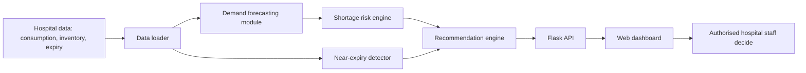
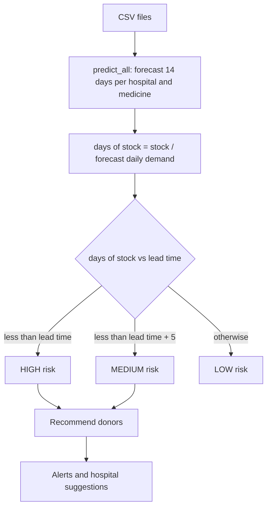

# Technical Design Document

## 1. Overview
MediBridge predicts medicine shortages and recommends inter-hospital stock sharing. It is a decision-support
tool: it suggests, and authorised hospital personnel decide. All data is synthetic.

## 2. System architecture

## 3. Data flow

## 4. Modules
**Prediction module (`predictor.py`)**: For each hospital-medicine pair, a linear regression on the last 60 days
(trend plus weekly seasonality) forecasts 14 days of demand. Days of stock is stock divided by average forecast
daily demand. Risk is HIGH if stock ends before the supply lead time, MEDIUM if the buffer is under 5 extra days.

**Recommendation module (`recommender.py`)**:
1. Units needed = 14-day forecast x 1.2 minus current stock.
2. A donor's shareable surplus = its stock minus its own 14-day forecast x 1.2 (so the donor never faces a shortage).
3. Batches with under 7 days to expiry are not shipped.
4. Donors are ranked: near-expiry stock first, then shortest distance (haversine formula).
5. Most urgent requests are served first and shared stock is not double counted.

**Near-expiry detector**: flags batches expiring within 30 days where stock exceeds what the hospital can use
before expiry, and estimates the units likely to be wasted.

## 5. Data model (CSV)
| File | Columns |
|------|---------|
| hospitals.csv | hospital_id, name, lat, lon |
| sample_data.csv | date, hospital_id, medicine, units_used |
| inventory.csv | hospital_id, medicine, stock, expiry_date, lead_time_days |

## 6. API
`GET /` dashboard page. `GET /api/dashboard` JSON with predictions, recommendations and near-expiry alerts.

## 7. Assumptions and limitations
Synthetic data; one batch per hospital-medicine; straight-line distance; simple linear model; regulatory
requirements for inter-hospital transfer must be checked by hospital staff.
